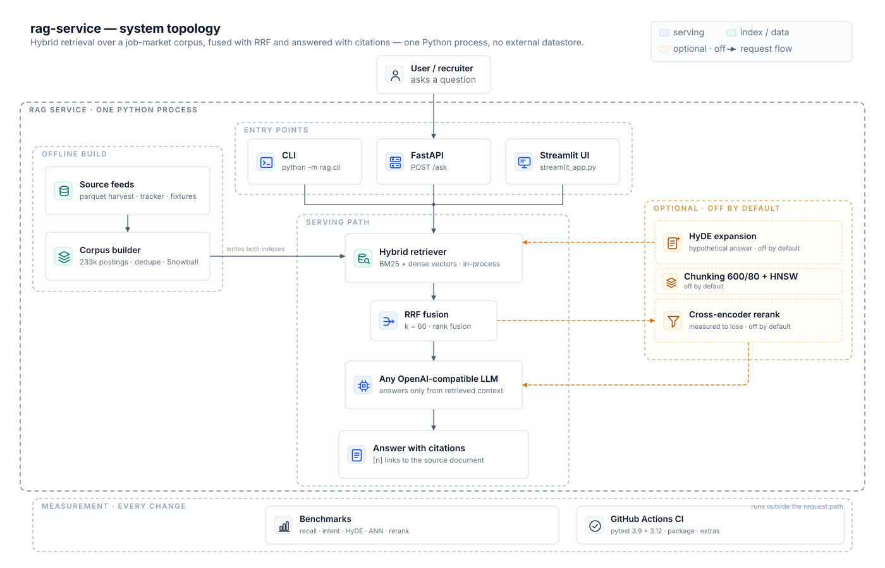

# job-market-rag

**Ask questions about your own job hunt in plain language, and get answers with citations.**


Retrieval over **2,569 job postings and application records** — BM25 and a dense
index, fused with Reciprocal Rank Fusion, answered by any OpenAI-compatible LLM,
with a citation on every claim.

Benchmarked on the queries people actually type — *"junior data jobs fully
remote"*, *"anything in data I can do with no experience"* — not on questions
that name the document. Hybrid retrieval satisfies **75% of real searches in the
top five, against 65% for BM25 alone**; the same pipeline loses to BM25 on
name lookup, and both results are in the tables.

```
$ python3 -m rag.cli "which junior jobs are in Barcelona?"
[1] Datavant — Junior Data Scientist
    https://…/datavant-junior
    Datavant junior data scientist Barcelona linked health records python sql
[2] Metyis — Data Engineering Analyst
    https://…/metyis-dea
    Metyis Barcelona data engineering analyst junior sql python etl
[3] Buynomics — Junior Data Scientist
    https://…/buynomics-js
    Buynomics junior data scientist Barcelona pricing analytics python pandas
```

---

## Quickstart

Thirty seconds, no API key, no network, no private data — a sixteen-document
corpus and eight answered questions are checked in.

```bash
git clone https://github.com/garasnote/rag-service && cd rag-service
pip install -e .
python3 eval/run_eval.py --corpus fixtures/corpus.json --questions fixtures/questions.json
python3 eval/run_intent.py --corpus fixtures/corpus.json --questions fixtures/questions_intent.json
python3 -m pytest -q
```

```
corpus: 16 documents | questions: 8 | embedder: hashing-512

config        hit@1  hit@3    MRR
bm25            88%   100%  0.917
dense           88%   100%  0.938
hybrid          88%   100%  0.938
hybrid 3:1      88%   100%  0.917

mode       sat@1   sat@3   sat@5     (intent questions)
bm25         83%     83%     83%
dense        67%     83%     83%
hybrid       83%     83%     83%
```

Point it at your own records — a JSON list of `{id, title, text, url}` — and ask
for rankings:

```bash
python3 -m rag.cli "remote LLM roles in Spain" --corpus my_postings.json -k 5
```

A one-page front end, if you would rather click than type:

```bash
pip install -e ".[ui]"
streamlit run streamlit_app.py
```

Optional extras, none of them needed for the quickstart: `.[embeddings]` (real
MiniLM encoder), `.[ann]` (hnswlib), `.[rerank]` (cross-encoder), `.[api]`
(FastAPI service), `.[ui]` (Streamlit), `.[dev]` (pytest, ruff).

---

## How it works



Three zones: ingestion builds both indexes offline, serving answers a request in
milliseconds, and measurement gates every change. Nodes are modules that exist;
dashed paths are optional and off by default.

```
        ┌──────────────┐   ┌────────────────┐      one document per posting,
        │ job tracker  │   │ ATS warehouse  │      every one keeps its URL
        │   (JSON)     │   │    (SQLite)    │
        └──────┬───────┘   └───────┬────────┘
               └────────┬──────────┘
                        ▼
                 ┌─────────────┐
                 │   corpus    │   2,569 documents, deduplicated by URL
                 └──────┬──────┘
            ┌───────────┴────────────┐
            ▼                        ▼
     ┌─────────────┐          ┌─────────────┐
     │    BM25     │          │    dense    │   brute-force cosine over
     │  Okapi, k1  │          │    index    │   L2-normalised vectors
     └──────┬──────┘          └──────┬──────┘
            └───────────┬────────────┘
                        ▼
                 ┌─────────────┐
                 │     RRF     │   rank fusion, optional weighting
                 └──────┬──────┘
                        ▼
                 ┌─────────────┐
                 │  LLM answer │   OpenAI-compatible, forced to cite [n]
                 │  + sources  │   every claim maps to a numbered document
                 └─────────────┘
```

**No framework.** BM25 is fifty lines of Okapi, the vector index is a cosine
loop, RRF is five lines, the eval harness is a list of questions. A framework
would hide the parts worth reading.

---

## Results

Two benchmarks, because a job search is two different searches. Neither is the
one RAG demos usually ship.

### 1. Searching by intent — what you actually type

Twenty queries a person would really run on a bad Tuesday: "junior data jobs
fully remote", "algo de datos que pueda hacer sin experiencia", "Power BI job in
Colombia". No company names. The right answer is **any document that satisfies
the constraints**, so this scores satisfaction at k, not recall of one gold row:

| embedder | mode | sat@1 | sat@3 | sat@5 |
|---|---|---|---|---|
| hashing-512 | bm25 | 40% | 65% | 65% |
| hashing-512 | dense | 30% | 30% | 35% |
| hashing-512 | hybrid | 40% | 50% | 60% |
| multilingual-MiniLM | bm25 | 40% | 65% | 65% |
| multilingual-MiniLM | dense | 35% | 60% | 65% |
| multilingual-MiniLM | **hybrid** | **50%** | **70%** | **75%** |

Split by language, multilingual encoder: Spanish `bm25 70%` / `dense 60%` /
**`hybrid 80%`** at 5; English `bm25 60%` / `dense 70%` / `hybrid 70%`. English
queries gain the most from the dense side, which is what a cross-lingual encoder
is for.

### 2. Searching by name — the easy case

Same 15 questions in Spanish and English, each naming a company, 2,576 documents:

| embedder | config | hit@1 | hit@3 | MRR |
|---|---|---|---|---|
| hashing-512 | bm25 | **50%** | **70%** | **0.594** |
| hashing-512 | dense | 33% | 47% | 0.394 |
| hashing-512 | hybrid | 53% | 63% | 0.572 |
| multilingual-MiniLM | dense | 30% | 40% | 0.340 |
| multilingual-MiniLM | hybrid | 43% | 63% | 0.533 |

### 3. Paraphrase, no entities at all

| config | hit@1 | hit@3 | MRR |
|---|---|---|---|
| bm25 | 0% | 0% | 0.000 |
| dense (multilingual) | 0% | 12% | 0.042 |
| dense (hashing) | 12% | 12% | 0.125 |

### 4. HyDE, measured instead of assumed

Same 20 intent queries, three DeepSeek samples per query, each retrieved and the
rankings fused with RRF. Two prompts: the paper's "write a 4–6 sentence passage",
and one that asks for a **record in the corpus's own shape** — `Company — Role ·
City · seniority · stack` — because the documents are two-line records, not prose.

| hypothetical style | fused sat@1 | fused sat@3 | fused sat@5 | single sat@5 |
|---|---|---|---|---|
| none — bm25 | 40% | 65% | 65% | — |
| none — hybrid | **55%** | **70%** | **75%** | — |
| prose passage (paper prompt) | 20% | 30% | 35% | 25% |
| record-shaped | 10% | 35% | 55% | 55% |

The prompt shape is worth **+20 points** (35% → 55% at k=5): asking for a passage
makes the model write a paragraph about the job market, which is nowhere near a
record in embedding space; asking for a record makes it invent a plausible
`Tinybird — Junior Data Analyst · Remote · junior · sql python dbt`, which at
least lives in the right neighbourhood. But even the better prompt still loses to
simply using the query — 55% against 75% — so HyDE stays off by default here,
and the samples are checked in as `eval/hyde_intent_samples.json` so the number
can be reproduced without spending a token.

On the entity benchmark with the paper prompt, HyDE scored 0.419 MRR against
0.622 for plain BM25 — the same story from the other direction.

---

### 5. Six changes, measured before being kept

Each of these was built on its own branch, measured against the same 20 intent
questions, and kept only if the number moved. Two of them lost and are off.

| change | what it cost | measured effect | default |
|---|---|---|---|
| Spanish Snowball stemmer with an entity guard | stdlib, ~0 ms | bm25 sat@1 40% → 55%, sat@5 65% → 75% | off (`--stem es`) |
| Cross-encoder rerank, ms-marco, pool 40 | ~90 MB model, second pass | bm25 40/65/65 → **65/85/85** | off (`--rerank cross`) |
| Lexical rerank, idf overlap, pool 40 | stdlib | bm25 40/65/65 → 45/75/80 | off (`--rerank lexical`) |
| Chunked scoring, for passage citations | 1.02 windows/doc | sat@5: bm25 65% → 70%, dense 35% → 40%, hybrid flat | on in the API, off in eval |
| HNSW ANN index | hnswlib, 86 ms build | recall@10 0.97 at ef=50; 0.15 ms vs 0.16 ms for exhaustive numpy | **off** |
| HyDE, record-shaped prompt | an LLM call per query | 55% sat@5 best case, against 75% for plain hybrid | **off** |

The ANN result is the one worth reading twice: the graph is 100× faster than the
stdlib scan, but a numpy matrix product is exact, dependency-free and just as
fast at this size. Approximation only starts paying somewhere north of a hundred
thousand documents, and that is where the eval has to be re-run.

The full per-workstream measurements — commands, load averages, the configurations
that lost — are in [`docs/notes/`](docs/notes/), one file per change.

Chunking barely fired: only 33 of 2,571 postings are longer than 600 characters,
so 1.02 windows per document. It earns its place through citation precision, not
through retrieval, and the table says so instead of implying a retrieval win.

## What the numbers say

**Intent search is where the pipeline earns its keep.** Hybrid with the
multilingual encoder satisfies 75% of real queries in the top five against 65%
for BM25 alone, and 80% on the Spanish half. That is the metric that matters,
because it is the search a person with no job actually performs.

**The 113 MB encoder is worth it for intent and worthless for names.** On
entity queries it loses to 512 dimensions of hashed bag-of-words (0.340 vs
0.394), because a transformer collapses "Datavant junior in Barcelona" and
"Buynomics junior in Barcelona" into nearly the same point — fatal when the
company name *is* the query. On intent queries the same model adds ten points,
because "junior jobs remote" and "remoto junior" finally land in the same place.

**Which is why the benchmark everyone writes is the wrong one.** The standard
RAG demo evaluates questions that name the document — and on those BM25 wins, so
the demo concludes BM25 wins. Change the questions to what a searcher types and
the ranking flips. The benchmark chooses the winner.

**Hybrid beats both, never by accident.** Every question BM25 misses on intent
is a question where the words differ, not the meaning: *"junior data jobs fully
remote"* against documents that say `remoto`, *"graduate in AI"* against
`inteligencia artificial`. Fusing ranks lets the dense side cover the vocabulary
gap without letting it outvote exact matches.

**HyDE still loses by a third.** Hypothetical passages are fluent prose; the
documents are two-line records, and the invented company names in the passage
drag retrieval toward the wrong rows. Implemented, measured, off.

**Failures are printed, not averaged away.** The harness lists which queries no
configuration satisfies — usually data gaps, like a record whose notes never
mention the stack that was asked for.

---

## Design decisions

**Standard library core.** Retrieval, fusion and evaluation run on
`pip install -e .` and nothing else. Heavy pieces are extras: `.[embeddings]` for
ONNX encoders, `.[api]` for HTTP. A reviewer can reproduce the benchmark on a
fresh machine in under a minute.

**Deterministic evaluation.** Thirty questions with known answers, scored by hit
rate and MRR, no LLM in the loop. A judge model would make the numbers
unreproducible and the comparison worthless.

**RRF instead of score normalisation.** BM25 scores and cosine similarities live
on different scales; fusing ranks avoids a weighted sum whose weights nobody can
defend. The 3:1 variant exists to test whether BM25 deserves more weight — it
does, marginally, and the table shows it.

**Citations are structural.** The prompt forces `[n]` markers and the API returns
a `sources` array beside the answer, so a client renders links without parsing
prose. Retrieval always carries URLs, never bare text.

**Fixtures, not private data.** The corpus is a personal job tracker and is not
in the repo. `fixtures/` holds a small representative corpus plus questions,
which is what CI runs.

---

## API

```bash
pip install -e ".[api]"
uvicorn api:app --port 8100

curl -s localhost:8100/search -H 'content-type: application/json' \
     -d '{"q":"junior computer vision Spain","k":5}'

curl -s localhost:8100/ask -H 'content-type: application/json' \
     -d '{"question":"which junior roles mention PyTorch?","k":5}'
```

`POST /search` returns ranked documents; `POST /ask` returns
`{"answer": "...", "sources": [{"n": 1, "title": "...", "url": "...", "snippet": "..."}]}`.
Sources also carry `chunk_index`, `start` and `end`, so a citation points at the
passage that matched rather than at the whole posting. Set `RAG_CHUNK=0` to index
whole documents instead.

Set `OPENAI_BASE_URL`, `OPENAI_API_KEY` and `OPENAI_MODEL` to any
OpenAI-compatible endpoint. Without a key the retrieval half still works, and
`hyde` falls back to an oracle stand-in that is labelled as such in every output
it touches.

---

## Limitations

- **Twenty intent questions and fifteen entity questions is a small benchmark.**
  One question is five percentage points. Enough to rank configurations against
  each other, not enough to claim absolute quality.
- **ANN is implemented but not adopted.** At 2,571 documents an exhaustive numpy
  scan is exact and equally fast; the graph costs a dependency and 86 ms of
  build time. Revisit at 100k, with the same recall-versus-latency bench.
- **The reranker that wins needs a model download.** The cross-encoder is the
  best configuration measured (85% sat@5 at pool 40) and it is opt-in, because a
  second pass over every query is a deployment decision, not a default.
- **Chunk-level citations are barely exercised here.** Only 33 postings exceed
  600 characters, so the windowing path is proven by tests more than by data.
- **Spanish stemming helps intent and slightly hurts entity hybrid.** 40% → 55%
  at sat@1 for bm25, but hybrid hit@3 drops 73% → 67% on 15 entity questions.
  That is why it is a flag and not the default.
- **Answers are only as good as retrieval.** The model is constrained to the
  retrieved context, so a miss stays a miss — it will say so rather than invent.

## Roadmap

- [x] ANN index (hnswlib) with a recall-versus-latency measurement — measured, not adopted
- [x] A reranker that is measured to help — cross-encoder at pool 40, opt-in
- [x] Spanish lemmatisation with a real stemmer, ablation kept in `eval/`
- [x] Chunk-level citations for long postings
- [x] Streamlit front end over `/ask`
- [ ] Re-run the ANN bench at 100k documents, where approximation should start paying
- [ ] A corpus with long postings, so chunking is measured on more than 33 documents
- [ ] Decide whether the cross-encoder reranker is worth a default second pass

## License

WTFPL v2 — do what the fuck you want. See [LICENSE](LICENSE).
